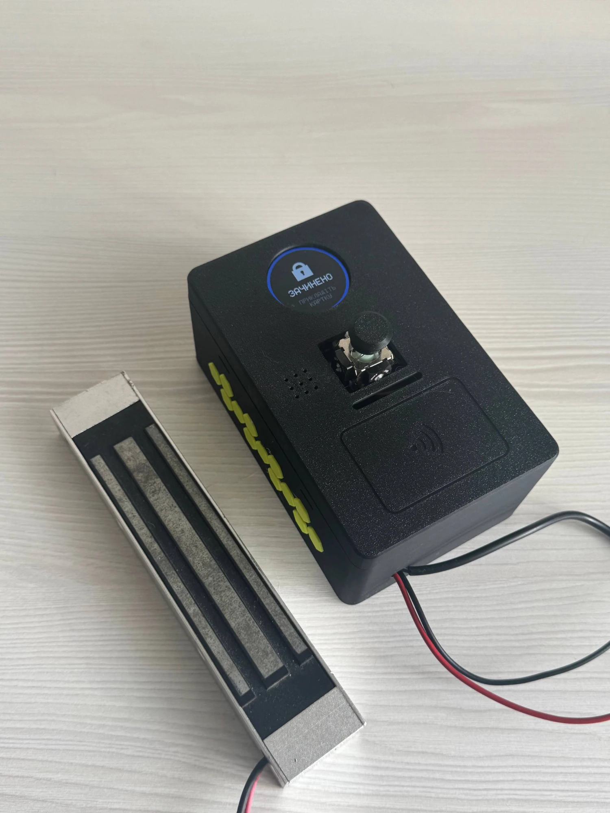
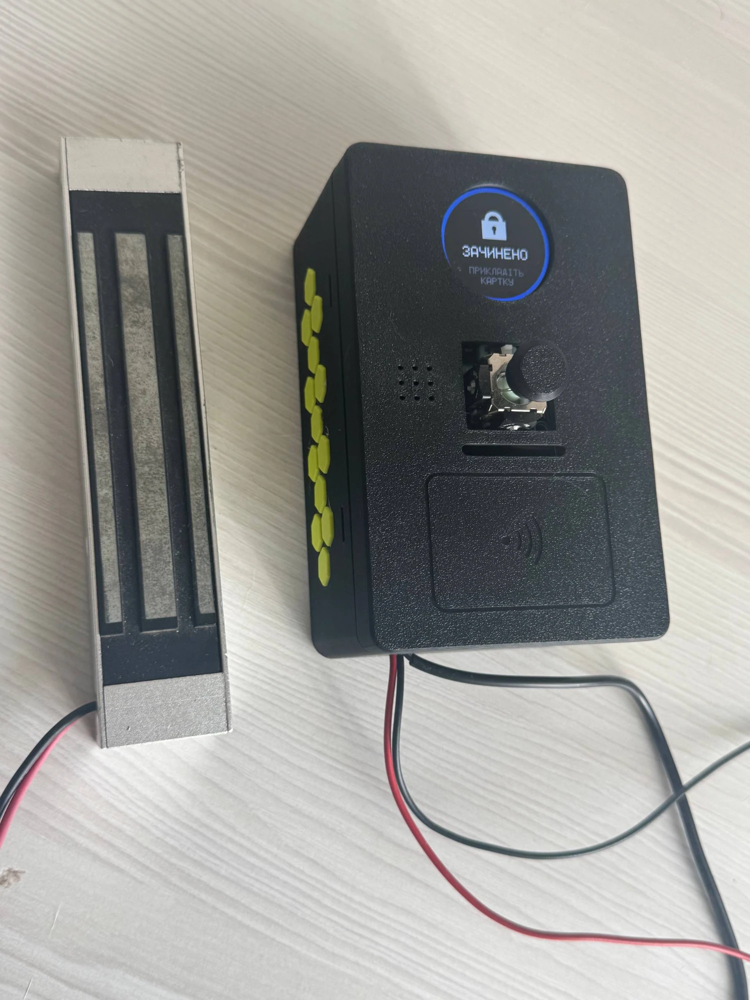
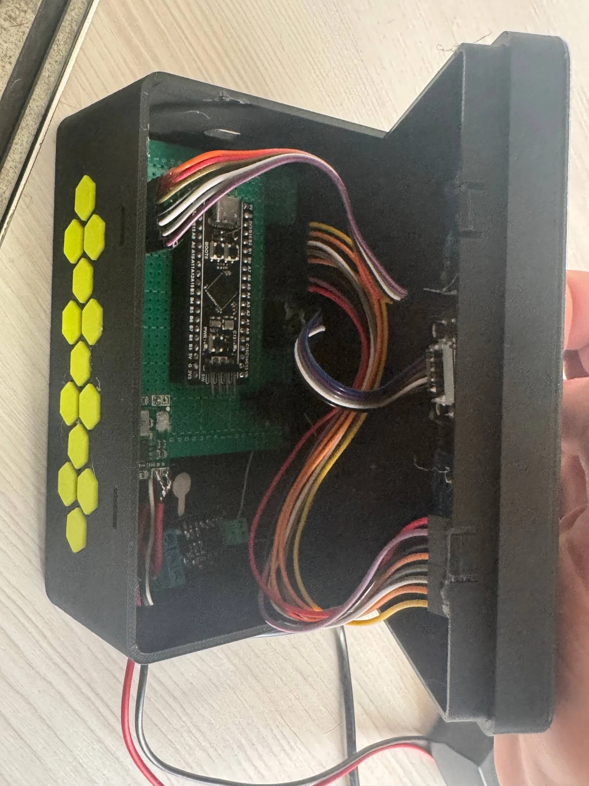
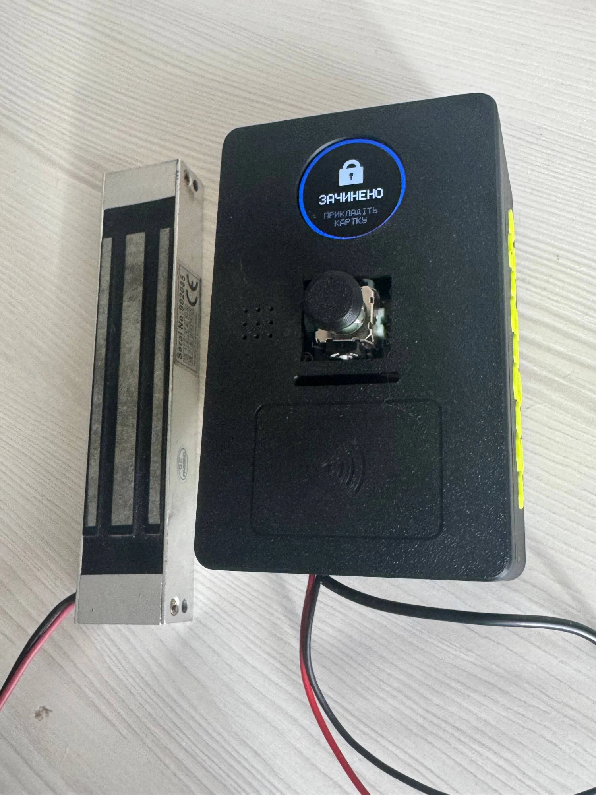
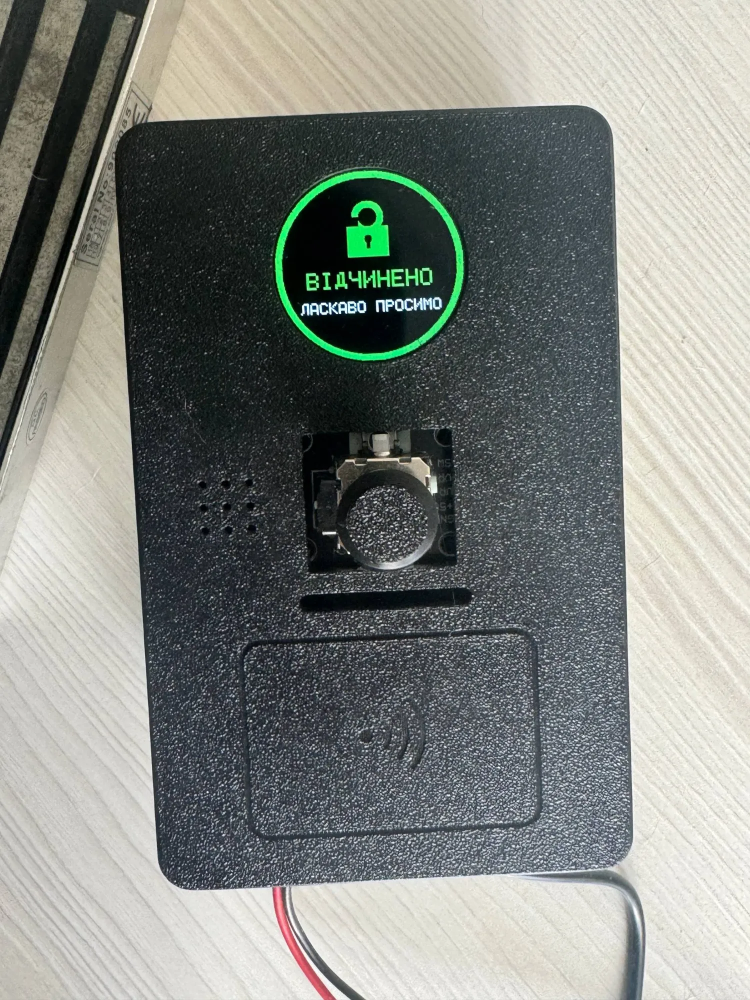
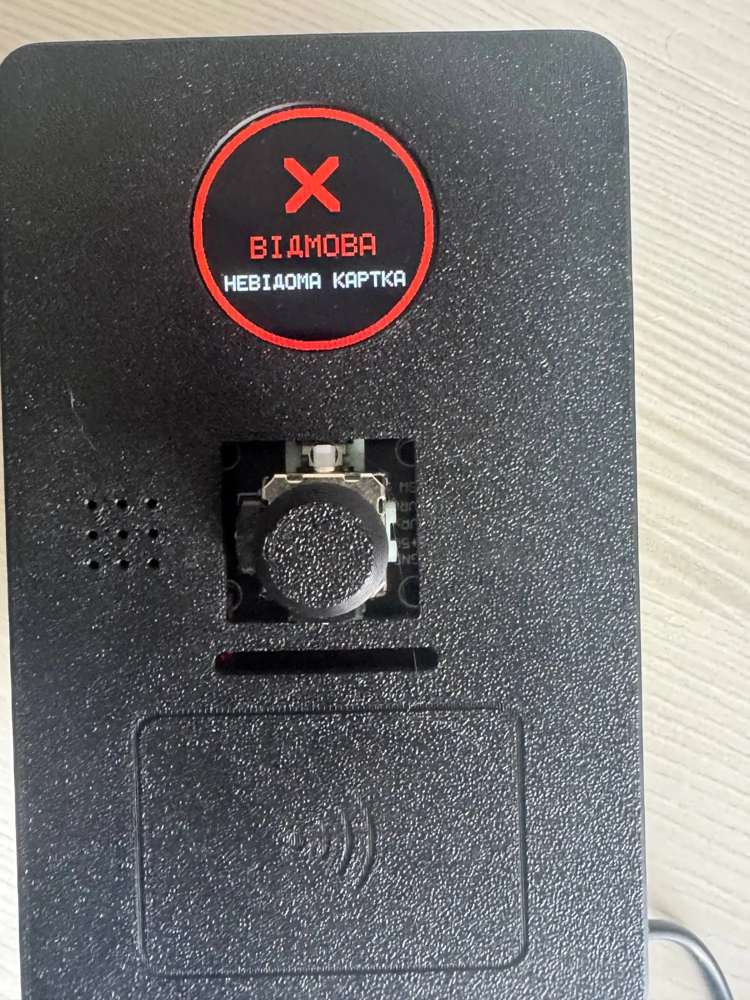
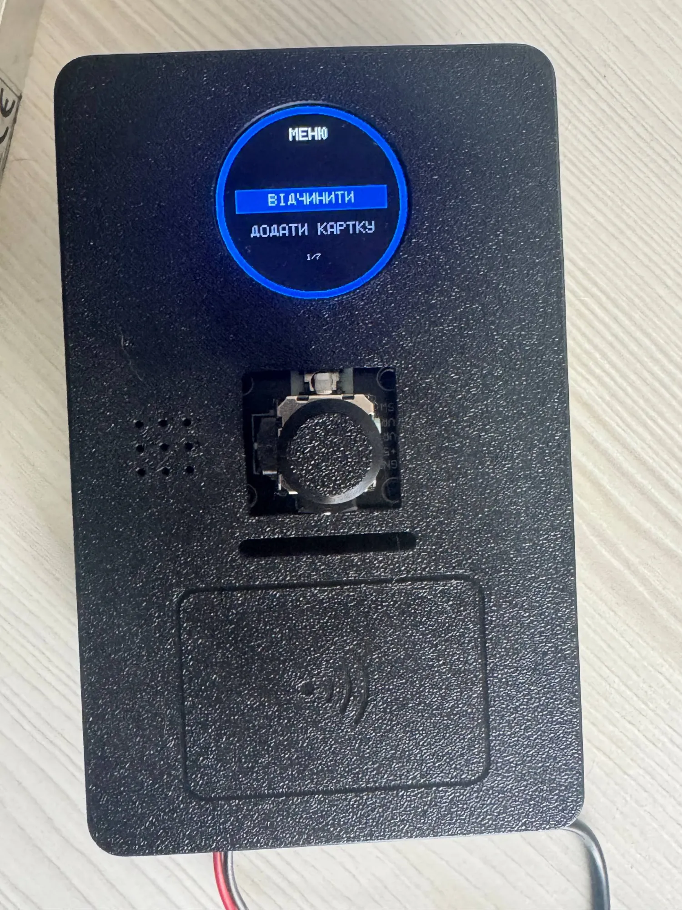
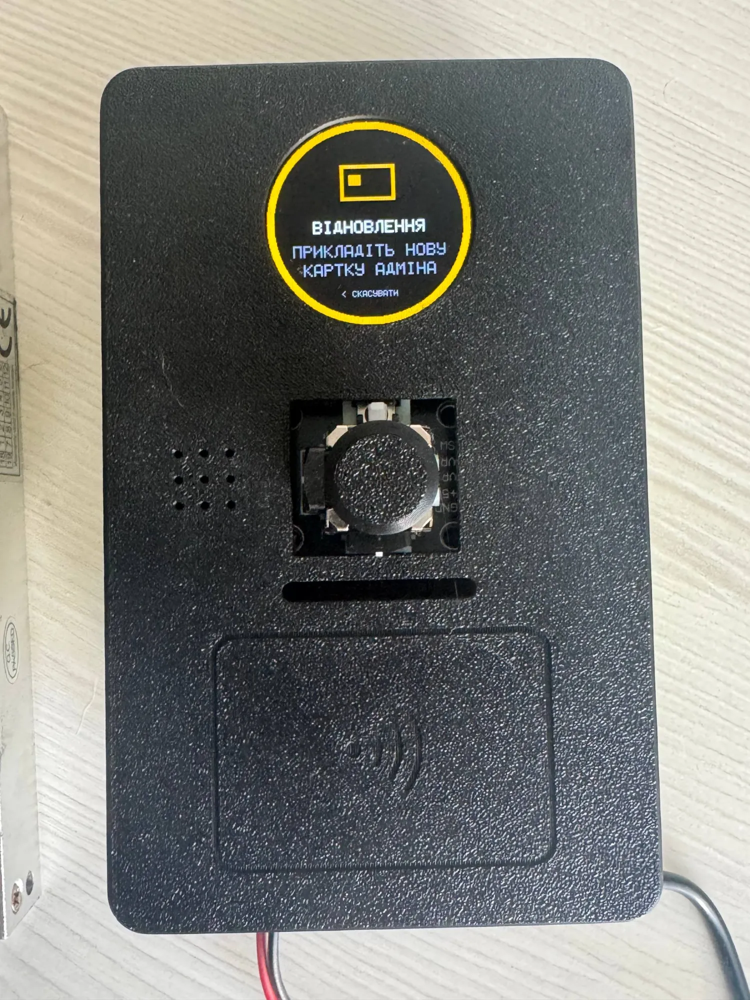
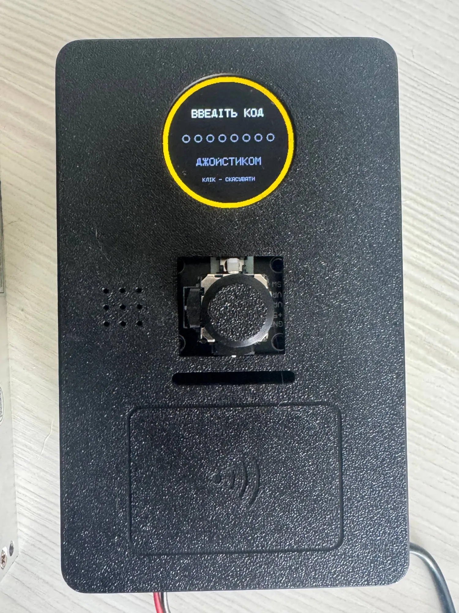
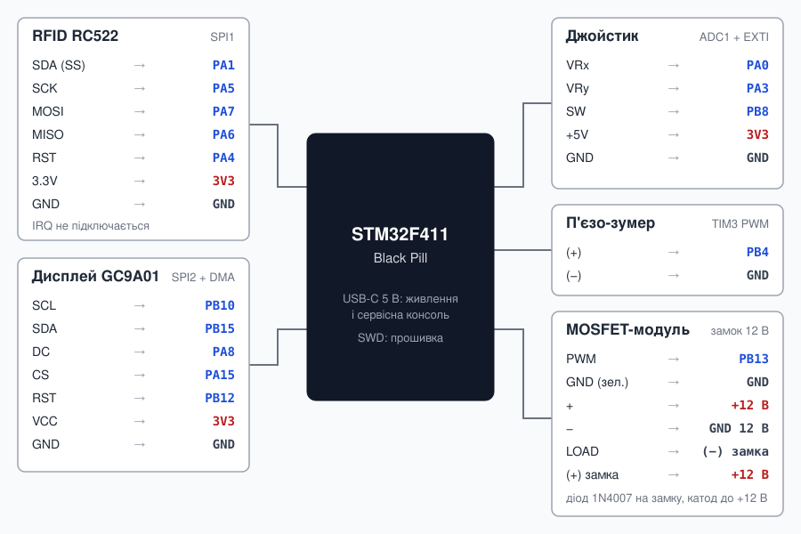

# SmartDoorLock

[](https://github.com/VelikiyNazarchik/SmartDoorLock/actions/workflows/ci.yml)
[](LICENSE)

[Українською](README.md) · **English**

**RFID access control door lock on an STM32F411 with FreeRTOS.**

Tap a registered card and the door opens. An unknown card is rejected, and after five failed attempts the lock blocks itself. The administrator manages cards on the device itself, using a round colour display and a joystick. The card list is stored in the MCU's Flash and survives power loss.

<p align="center">
  
</p>

## Features

- **MIFARE cards (13.56 MHz)**: up to 64 cards, including admin cards.
- **On-device menu**: open the door, add a card or an admin, delete a card, view the event log, set the unlock time (1–30 s).
- **Brute-force protection**: 5 failed attempts within a minute lock the device for a minute, with an alarm.
- **Admin recovery without a programmer**: if the admin card is lost, a new one is assigned with a joystick code. Old admin cards stop working.
- **Random-UID rejection**: phones and many bank cards show a new UID on every tap, so they cannot be enrolled as keys.
- **Event log**: the last 64 events with timestamps.
- **Self-monitoring**: if any task hangs, the watchdog resets the device and the reset reason is saved.
- **Power-loss-safe storage**: the card list has a CRC32, and a power cut during a write never leaves it half-written.
- **USB service console**: status, cards, log, clock, diagnostics.

## Photos

| Device and electromagnetic lock | Inside the enclosure |
|:---:|:---:|
|  |  |

| | | |
|:---:|:---:|:---:|
| <br>Waiting for a card | <br>Access granted | <br>Unknown card |
| <br>Admin menu | <br>Recovery: new card | <br>Recovery: joystick code |

## Hardware

| | |
|---|---|
| MCU | STM32F411CEU6 (Cortex-M4F, 96 MHz), Black Pill board |
| RTOS | FreeRTOS (CMSIS-RTOS v2), 7 tasks |
| Card reader | RC522, SPI1 |
| Display | 1.28" round IPS GC9A01, 240×240, SPI2 + DMA |
| Input | analog joystick with a push button (ADC1 + EXTI) |
| Lock | 12 V electromagnetic lock through a MOSFET module |
| Sound | passive piezo buzzer, TIM3 PWM |
| Storage | 64 cards in Flash sector 7, CRC32 |
| Service | USB-C virtual COM port |

<p align="center">
  
</p>

## Firmware design

- **One owner task per peripheral**: RC522, display, ADC and USB are each touched by exactly one task, so there are no bus mutexes or races.
- **All events go to one queue** (`qCtrl`). The control task feeds them to a **state machine with no HAL calls**. It acts on the world through six `IO_*` functions (lock, sound, timer, screen, log, storage). On the board `tCtrl` implements them; in the PC tests a fake records the calls.
- **State changes only in `go_to()`**, so lock, timer and screen always match the current state.
- **Flash write order**: cards first, header last. A power cut mid-write leaves the list either intact or empty, never corrupted. Every change keeps an undo copy and is rolled back if the write fails.
- **Supervisor + IWDG (~4 s)**: every task reports a heartbeat, and the watchdog is fed only if all tasks are alive. 4 s because erasing a Flash sector stalls the CPU for up to 2 s.
- **Recovery code is checked only after the last step**, so it cannot be guessed one step at a time.

Details (in Ukrainian): [architecture](docs/architecture.md) · [state machine](docs/state_machine.md) · [pinout](docs/pinout.md) · [test plan](docs/test_plan.md)

## Build

**STM32CubeIDE 2.x**: *File → Import → Existing Projects into Workspace* → `firmware-stm32/SmartDoorLock` → *Build*. Flash with an ST-Link.

**Command line** (any `arm-none-eabi-gcc`, the same script runs in CI):

```bash
bash firmware-stm32/SmartDoorLock/Tools/build_firmware.sh
```

**Host unit tests** (gcc + make): state machine, card list (incl. simulated power loss during a save), joystick math, event log, calendar.

```bash
make -C firmware-stm32/SmartDoorLock/Tests
```

All tunables (timings, thresholds, lock type, joystick orientation, recovery code) are in `App/Inc/app_config.h`.

## Limitations

- Cards are identified by UID, which can be cloned. Higher-security sites need cryptographic cards (MIFARE DESFire).
- 13.56 MHz only; 125 kHz fobs and iButton need a separate reader.
- The recovery code is the same for every device running this firmware; change it in `app_config.h` before installing.

## License

MIT, see [LICENSE](LICENSE). STM32 HAL, CMSIS, the USB Device Library and FreeRTOS keep their own licenses.
