# SmartDoorLock

**Електронний замок з доступом за RFID-картками на STM32F411 і FreeRTOS.**

Прикладаєш картку — двері відчиняються. Чужа картка — відмова, а після п'яти спроб замок блокується. Адміністратор керує картками прямо на пристрої: круглий кольоровий екран і джойстик. Список карток зберігається в пам'яті мікроконтролера й не губиться після вимкнення живлення.

<p align="center">
  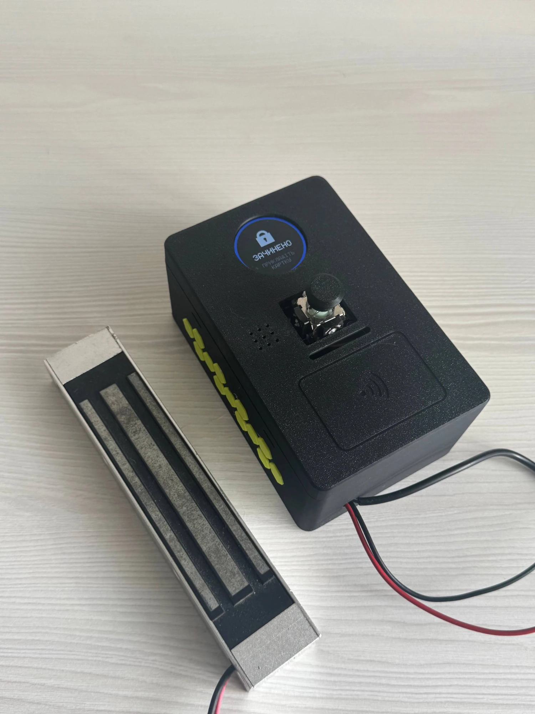
</p>

## Можливості

- **Доступ за картками MIFARE (13,56 МГц)**: до 64 карток, серед них адміністратори.
- **Меню на пристрої**: відчинити двері, додати картку або адміна, видалити картку, переглянути журнал, змінити час відкриття (1–30 с).
- **Захист від перебору**: 5 невдалих спроб за хвилину — блокування на хвилину із сиреною.
- **Відновлення доступу без програматора**: якщо адмін-картку загублено, нового адміна можна призначити кодом на джойстику. Стара картка при цьому перестає діяти.
- **Відсікання «плаваючих» карток**: телефон і банківська картка щоразу показують новий номер, тому як ключ не реєструються.
- **Журнал подій**: 64 останні події — хто, коли й що зробив.
- **Самоконтроль**: якщо будь-яка частина програми зависне, пристрій сам перезавантажиться і запише причину.
- **Захищене збереження**: список карток має контрольну суму; збій живлення під час запису не зіпсує його.
- **Сервісна консоль через USB**: стан, картки, журнал, годинник, діагностика.

## Фото

| Пристрій і електромагнітний замок | Всередині корпусу |
|:---:|:---:|
| 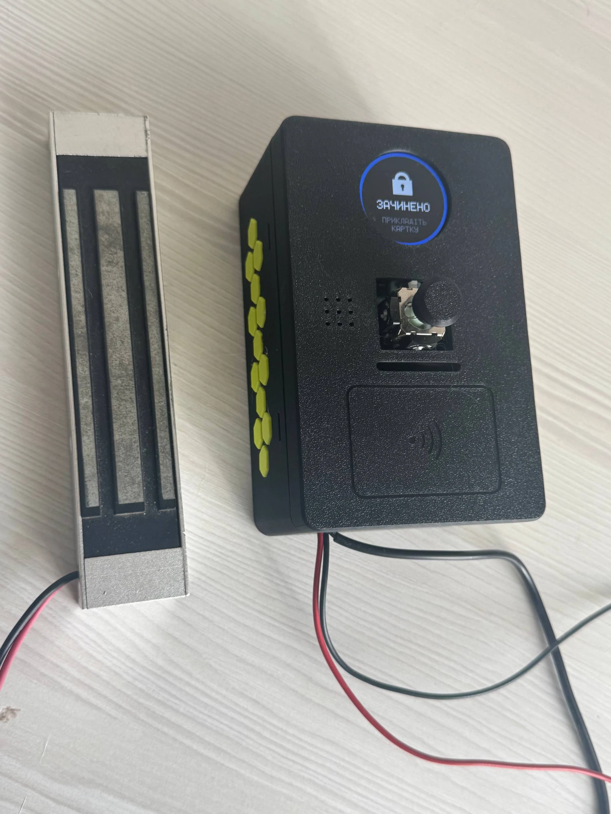 | 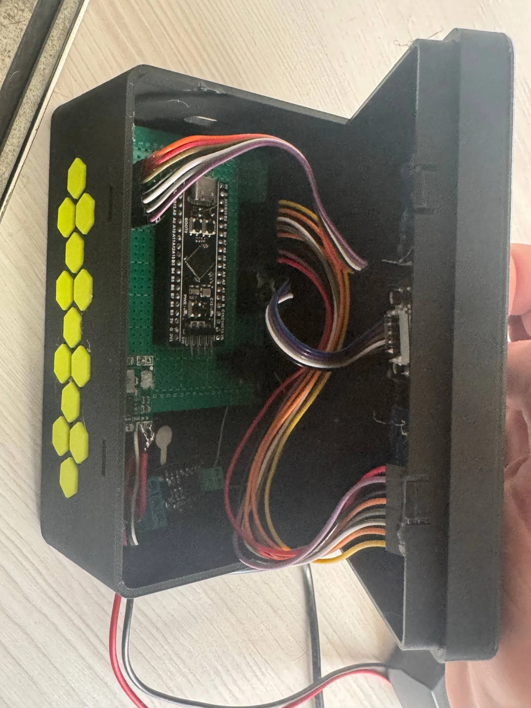 |

**Екрани**

| | | |
|:---:|:---:|:---:|
| 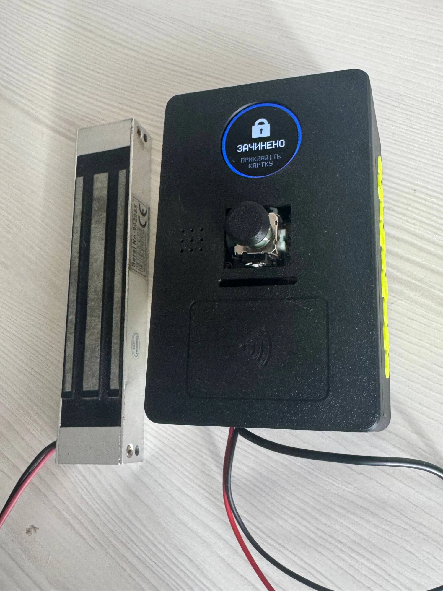<br>Очікування картки | 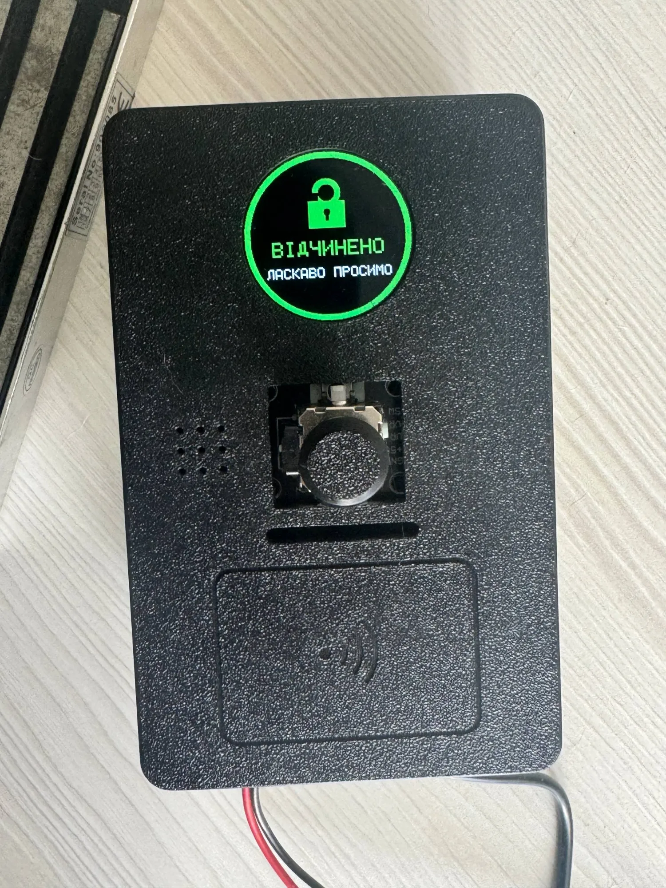<br>Доступ дозволено | 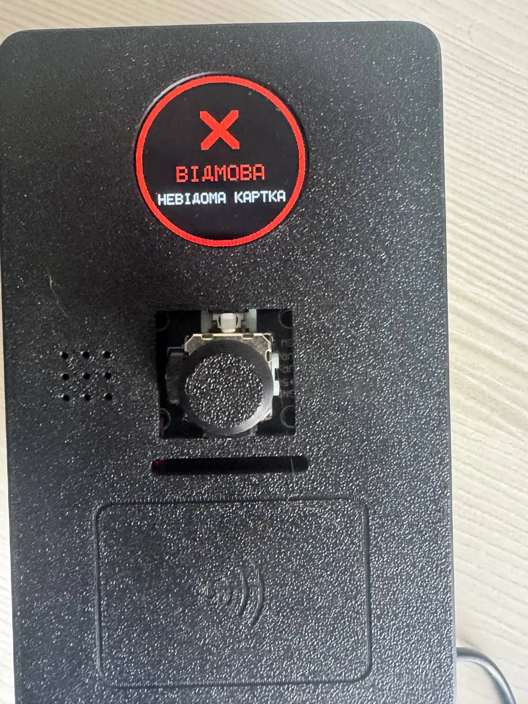<br>Чужа картка |
| 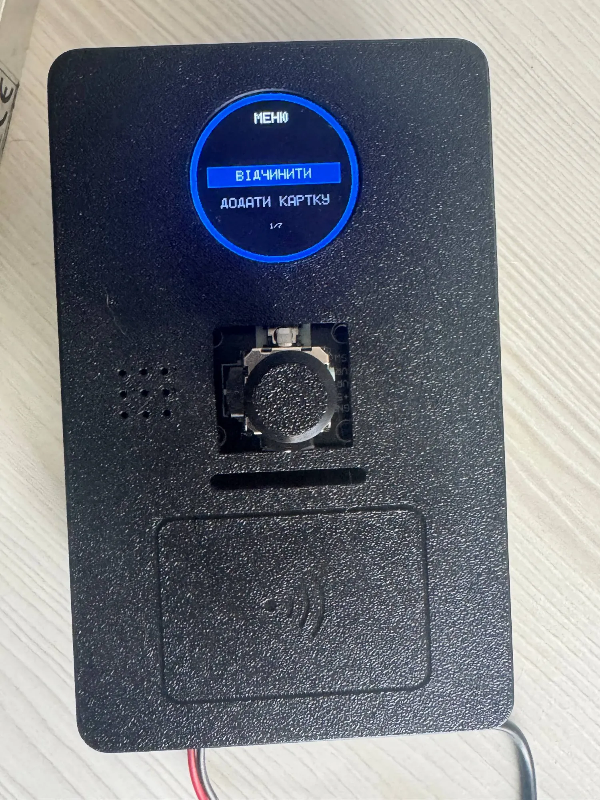<br>Меню адміністратора | 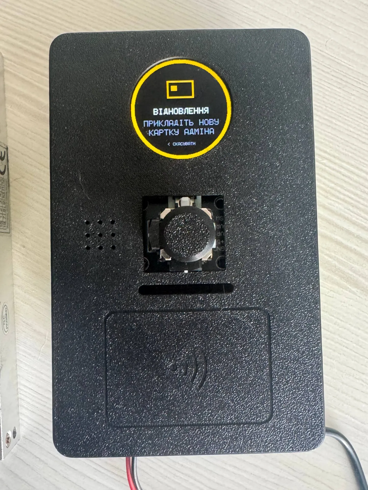<br>Відновлення: нова картка | 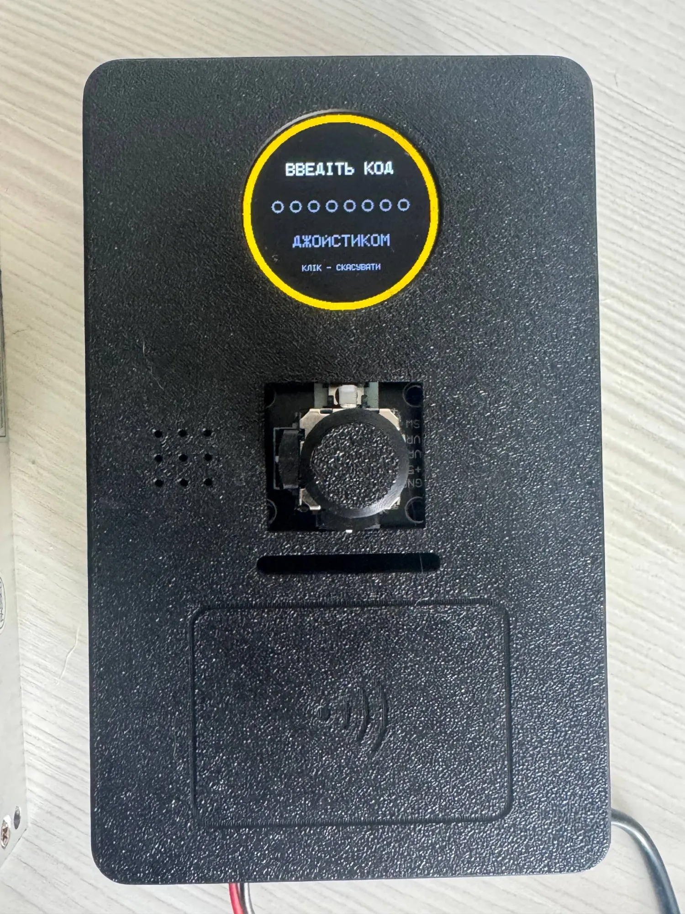<br>Відновлення: код джойстиком |

## Як користуватися

**Перше ввімкнення.** На екрані «НАЛАШТУВАННЯ». Утримайте кнопку джойстика 3 секунди, прикладіть картку і введіть код джойстиком: ↑ ↑ ↓ ↓ ← → ← →. Картка стає картою адміністратора.

**Вхід.** Своя картка — «ВІДЧИНЕНО», двері відчинені на заданий час. Чужа — «ВІДМОВА».

**Меню.** Прикладіть картку адміністратора. Джойстик: ↑ ↓ — вибір пункту, → або натискання — підтвердити, ← — назад. Меню закривається саме через 30 секунд без дій.

| Пункт | Що робить |
|---|---|
| Відчинити | відчиняє двері |
| Додати картку | прикладіть нову картку — вона відчинятиме двері |
| Додати адміна | те саме, але картка отримує доступ до меню |
| Видалити картку | вибрати картку зі списку й підтвердити; останнього адміна видалити не можна |
| Журнал | останні події з часом і номером картки |
| Час відкриття | 1–30 секунд |

**Загубили картку адміністратора.** Утримайте кнопку джойстика 3 секунди, прикладіть нову картку і введіть код. Нова картка стає єдиним адміном, старі адмін-картки видаляються, звичайні лишаються. Помилку в коді видно лише після всіх кроків, а невірний код рахується як невдала спроба.

**Блокування.** Після 5 невдалих спроб за хвилину пристрій хвилину не відчиняється жодною карткою, на екрані відлік часу.

## Характеристики

| Параметр | Значення |
|---|---|
| Мікроконтролер | STM32F411CEU6 (ARM Cortex-M4F, 96 МГц) |
| Операційна система | FreeRTOS, 7 задач |
| Картки | MIFARE / ISO 14443A, 13,56 МГц, UID 4 або 7 байтів |
| Зчитувач | RC522, SPI |
| Екран | круглий IPS 1,28", 240×240, SPI + DMA |
| Керування | аналоговий джойстик з кнопкою |
| Замок | електромагнітний 12 В через MOSFET (тип замка налаштовується) |
| Звук | пасивний зумер, апаратний PWM |
| Пам'ять карток | 64 картки у Flash з контрольною сумою CRC32 |
| Журнал | 64 події з часом від годинника реального часу |
| Живлення | плата — USB-C 5 В, замок — 12 В |
| Сервісний інтерфейс | USB-C (віртуальний COM-порт) |

<p align="center">
  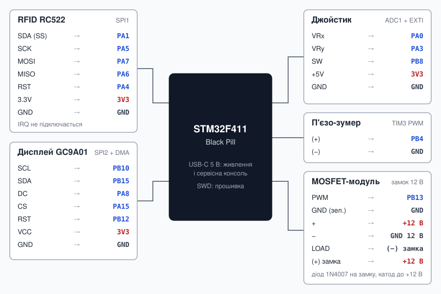
</p>

Розпіновка — [docs/pinout.md](docs/pinout.md), компоненти — [hardware/bom.md](hardware/bom.md).

## Як влаштована прошивка

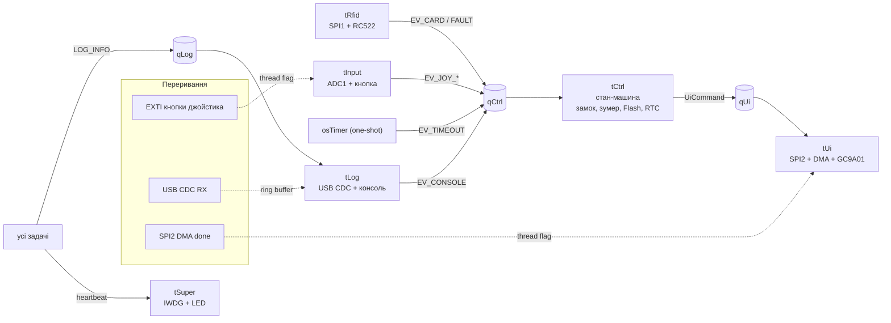

**Кожна периферія має одну задачу-власника**, тому на шинах немає м'ютексів і гонок. Усі події стікаються в одну задачу `tCtrl`, а вона передає їх стан-машині, яка вирішує, що робити. Стан-машина не містить HAL: вона діє на світ через шість функцій `IO_*` (замок, звук, таймер, екран, журнал, збереження). На платі їх реалізує `tCtrl`, у тестах на ПК — підробка, яка записує виклики.

**Шлях картки від антени до замка:**
1. `tRfid` раз на 100 мс питає RC522 по SPI1: «є картка?». Якщо є, читає UID і кладе подію `EV_CARD` у чергу `qCtrl`.
2. `tCtrl` дістає подію і передає її стан-машині `AC_HandleEvent()` (`access_ctrl.c`).
3. Стан-машина шукає UID у списку. Своя картка → `go_to(AC_UNLOCKED)`, яка викликає `IO_Lock(true)`, `IO_Timer(…)` і `IO_Screen()`, плюс `IO_Sound(BUZZ_OK)` і `IO_Log(…)`.
4. `IO_*` у `tCtrl` роблять справжню роботу: пін замка, мелодія на TIM3, програмний таймер FreeRTOS, команда екрана в чергу `qUi`, запис у журнал.
5. Коли час виходить, таймер надсилає `EV_TIMEOUT` → `go_to(AC_LOCKED)` → замок зачинено.

| Модуль | Що робить і чому так |
|---|---|
| `access_ctrl.c` | Стан-машина: 14 станів, на кожен — коротка функція. Стан змінюється лише в `go_to()`, тому замок, таймер і екран завжди відповідають стану. |
| `access_list.c` + `storage.c` | Список карток у RAM і його копія у Flash з CRC32. Заголовок пишеться останнім, тож збій живлення посеред запису не лишить «напівсписку». Перед зміною — копія `undo`; якщо Flash не записалась, зміна відкочується. |
| `supervisor.c` | Кожна задача регулярно відмічає «я жива». `tSuper` годує watchdog, лише якщо живі всі. Зависла задача → ~4 с → апаратний reset, причина зберігається в backup-регістрі RTC. |
| `logger.c` + `task_log.c` | Будь-яка задача кладе рядок у чергу й іде далі; USB чіпає лише `tLog`. |
| `task_ui.c` + `ui_screens.c` | `tCtrl` надсилає «що показати», `tUi` малює. Великі блоки пікселів ідуть через DMA, процесор тим часом вільний. |
| `task_input.c` | Кнопка — через переривання EXTI, яке лише будить задачу; антидребезг і довге натискання — у задачі. Джойстик — АЦП кожні 20 мс, мертва зона й гістерезис. |
| `Drivers/BSP/*` | Драйвери RC522, GC9A01, графіки зі шрифтом з кирилицею, джойстика, зумера, замка. Знають лише свій чип. |

**Рішення, на які варто звернути увагу:**
- *Код відновлення перевіряється лише в кінці* — інакше його можна було б підбирати по одному кроку.
- *Watchdog з таймаутом 4 с* — стирання сектора Flash зупиняє процесор до 2 с.
- *Заголовок списку пишеться останнім* — при збої живлення список або цілий, або порожній, але ніколи не пошкоджений (тест `test_power_loss_during_save`).
- *Логіка без HAL* — стан-машина і список карток перевіряються на ПК, без плати.

Детально: [архітектура](docs/architecture.md) · [стан-машина](docs/state_machine.md) · [розпіновка](docs/pinout.md) · [тест-план](docs/test_plan.md) · [налаштування CubeMX](docs/cubemx.md) · [компоненти](hardware/bom.md)

## Збірка і прошивка

Проєкт для **STM32CubeIDE 2.x**: *File → Import → General → Existing Projects into Workspace* → папка `firmware-stm32/SmartDoorLock` → *Build* (Debug або Release). Прошивка — через ST-Link.

Без GUI:

```bash
stm32cubeidec.exe --launcher.suppressErrors -nosplash \
  -application org.eclipse.cdt.managedbuilder.core.headlessbuild \
  -data <тимчасовий-workspace> -import firmware-stm32/SmartDoorLock -build SmartDoorLock/Debug
```

Усі налаштування — часи, пороги, тип замка, орієнтація джойстика, код відновлення — в `App/Inc/app_config.h`. Як змінити периферію і перегенерувати код з `.ioc`, не втративши свій код, — у [docs/cubemx.md](docs/cubemx.md).

### Тести на ПК

```bash
cd firmware-stm32/SmartDoorLock/Tests
make
```

5 наборів, 1278 перевірок: стан-машина (переходи, блокування, таймаути, меню, перше налаштування і відновлення адміна), список карток (CRC, пошкоджені дані, імітація збою живлення посеред запису), математика джойстика, журнал, календар.

| Метрика | Значення |
|---|---|
| Flash, Release / Debug | 61 КБ / 103 КБ з 384 КБ |
| RAM | 55 КБ з 128 КБ (з них 32 КБ — пам'ять FreeRTOS) |
| Попередження компілятора | 0 |
| Тести на ПК | 1278 перевірок, 0 помилок |

## Сервісна консоль

USB-C, будь-який термінал (PuTTY, Tera Term):

```
help                        список команд
stat                        причина останнього перезавантаження, пам'ять, стеки задач
status                      стан замка
cards / log                 список карток / журнал подій
time [YYYY-MM-DD HH:MM:SS]  показати / встановити годинник (UTC)
hang tCtrl                  перевірка watchdog: імітувати зависання задачі
reboot                      перезавантаження
```

## Структура репозиторію

```
docs/                     архітектура, стан-машина, розпіновка, тест-план, фото (images/)
hardware/bom.md           компоненти
firmware-stm32/SmartDoorLock/
├── SmartDoorLock.ioc     конфігурація CubeMX
├── .project, .cproject   проєкт STM32CubeIDE
├── STM32F411CEUX_FLASH.ld  лінкер-скрипт: Flash 384 КБ, останній сектор — дані
├── Core/ USB_DEVICE/ Drivers/STM32F4xx_HAL_Driver/ Middlewares/   генерує CubeMX
├── Drivers/BSP/          драйвери пристроїв
├── App/Inc, App/Src      задачі FreeRTOS, стан-машина, картки, журнал, екрани, супервізор
├── Tests/                тести на ПК
└── Tools/fontgen.py      генератор шрифту з українськими літерами
```

## Обмеження

- Ідентифікація за номером картки (UID): номер можна скопіювати. Для об'єктів з вищими вимогами потрібні захищені картки з криптографічною перевіркою (MIFARE DESFire).
- Підтримуються лише картки 13,56 МГц; домофонні брелоки 125 кГц і «таблетки» iButton потребують окремого зчитувача.
- Код відновлення однаковий для всіх пристроїв з цією прошивкою — перед встановленням його треба змінити в `app_config.h`.
- Кнопки виходу зсередини немає: двері відчиняються карткою або з меню.
- Без батарейки на VBAT годинник скидається при вимкненні живлення.

## Можливі розширення

- Віддалене відчинення і сповіщення через Wi-Fi-модуль (у прошивці вже виділено задачу й чергу під нього).
- Мобільний застосунок для керування картками.
- Підтримка брелоків 125 кГц через додатковий зчитувач.
