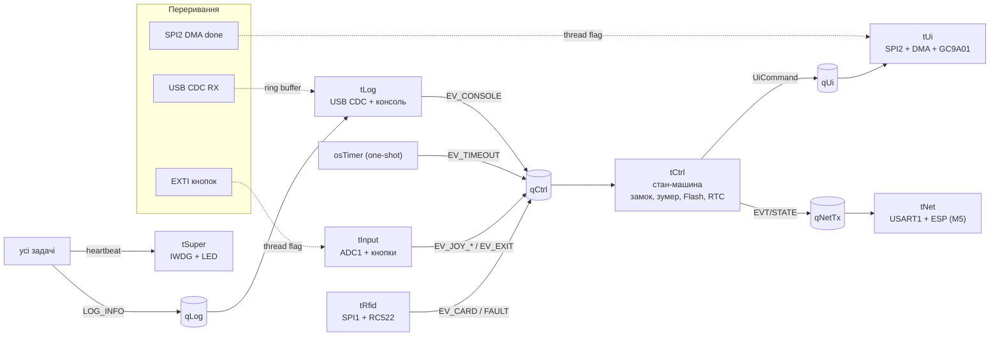

# STM32-SecureAccess — SmartDoorLock

Контролер доступу на **STM32F411 (Black Pill)** під **FreeRTOS**: RFID-картки (RC522), круглий дисплей GC9A01, джойстик для адмін-меню, електромагнітний замок через MOSFET, пасивний зумер на апаратному PWM. Список карток зберігається у Flash з CRC, система захищена watchdog-ом із супервізором задач, блокуванням після перебору карток і журналом подій.

> Статус: етапи **M0–M4** реалізовані (скелет, драйвери, основний цикл, збереження й меню, безпека). Мережа (ESP + MQTT, M5) і Android-застосунок (M6) — далі. Прошивка збирається без попереджень, логіка покрита тестами на ПК; перевірка на залізі — за [тест-планом](docs/test_plan.md).

## Що вміє

| | |
|---|---|
| **Доступ** | своя картка → замок відчинено на N с; чужа → «Відмова»; адмін-картка → меню |
| **Адмін-меню** | відчинити, додати / видалити картку, журнал подій, час відкриття (1–30 с) |
| **Захист від перебору** | 5 невдалих спроб за 60 с → блокування зчитувача на 60 с + сирена |
| **Кнопка виходу** | відчиняє завжди: у блокуванні, при збої зчитувача, у меню |
| **Первинне налаштування** | без адміна картку адміністратора приймають лише після кнопки виходу (вона всередині приміщення) |
| **Надійність** | watchdog + супервізор задач, CRC32 списку у Flash, запис «заголовок останнім», відкат при збої запису, причина перезавантаження в backup-регістрі RTC |
| **Журнал** | хто / коли / що: 64 останні події, мітки часу з RTC |
| **Звук** | різні мелодії через TIM3 PWM зі зміною частоти на льоту, без `HAL_Delay` |
| **Налагодження** | лог і консоль через USB-C (віртуальний COM-порт): `stat`, `cards`, `log`, `time`, `hang <task>`… |

## Архітектура



Принцип: **кожна периферія має одну задачу-власника**, тому на шинах немає м'ютексів і гонок. `tCtrl` — єдине місце, де ухвалюються рішення; решта задач — «органи чуття і руки». Стан-машина доступу — чиста функція без HAL (`подія + стан → новий стан + список дій`), тому вона повністю тестується на ПК.

Детально: [docs/architecture.md](docs/architecture.md) · [стан-машина](docs/state_machine.md) · [розпіновка](docs/pinout.md) · [тест-план](docs/test_plan.md) · [протокол STM32↔ESP](docs/uart_protocol.md) · [налаштування CubeMX](docs/cubemx.md) · [BOM](hardware/bom.md)

## Структура репозиторію

```
docs/                     архітектура, стан-машина, розпіновка, тест-план, протокол
hardware/bom.md           компоненти
firmware-stm32/SmartDoorLock/
├── SmartDoorLock.ioc     конфігурація CubeMX (96 МГц, SPI1/2, DMA, ADC, TIM3, IWDG, USB CDC, FreeRTOS)
├── .project, .cproject   проєкт STM32CubeIDE (App/ і BSP додані як source-папка та include-шляхи)
├── STM32F411CEUX_FLASH.ld  лінкер-скрипт: Flash 384 КБ, сектор 7 — дані
├── Core/ USB_DEVICE/ Drivers/STM32F4xx_HAL_Driver/ Middlewares/   генерує CubeMX
├── Drivers/BSP/          драйвери пристроїв: rc522, gc9a01, gfx (+шрифт з кирилицею), joystick, lock, buzzer
├── App/Inc, App/Src      задачі FreeRTOS і сервіси: access_ctrl, access_list, event_log, menu,
│                         ui_screens, logger, supervisor, app_time, flash_store, crc32, timeutil
├── Tests/                тести на ПК (gcc, без плати)
└── Tools/fontgen.py      генератор шрифту 5×7 (латиниця + українські літери)
```

## Збірка

Проєкт для **STM32CubeIDE 2.x**: *File → Import → General → Existing Projects into Workspace* → папка `firmware-stm32/SmartDoorLock` → *Build* (Debug або Release). Прошивка й налагодження — через ST-Link як зазвичай. Результат: `Debug/SmartDoorLock.elf`.

Без GUI (так само збирає CubeIDE, зручно для CI):

```bash
stm32cubeidec.exe --launcher.suppressErrors -nosplash \
  -application org.eclipse.cdt.managedbuilder.core.headlessbuild \
  -data <тимчасовий-workspace> -import firmware-stm32/SmartDoorLock -build SmartDoorLock/Debug
```

Як змінити периферію і перегенерувати код з `.ioc`, не втративши свій код, — у [docs/cubemx.md](docs/cubemx.md).

### Тести на ПК

```bash
cd firmware-stm32/SmartDoorLock/Tests
make
```

5 наборів, понад 1200 перевірок: стан-машина (усі переходи, блокування, таймаути, меню, налаштування), список карток (CRC, пошкоджені дані, симуляція збою живлення посеред запису), математика джойстика, журнал, календар.

## Цифри

| Метрика | Значення | Як отримати |
|---|---|---|
| Flash (Release / Debug) | 63 КБ / 108 КБ з 384 КБ | Build Analyzer у CubeIDE або `arm-none-eabi-size` |
| RAM | 56 КБ з 128 КБ (з них 32 КБ — heap FreeRTOS) | те саме |
| Попередження компілятора | 0 (`-Wall` для всього проєкту; власний код чистий і з `-Wextra`) | «Build Finished. 0 errors, 0 warnings» |
| Час повного кадру 240×240, DMA vs блокуючий SPI | вимірюється при старті | рядок `LCD full frame: …` у лозі |
| Використання стеку (на платі) | tCtrl 30 %, tRfid 41 %, tInput 40 %, tUi 24 %, tNet 63 %, tLog 16 % | команда `stat`, або з RAM за маркером 0xA5 |
| Heap FreeRTOS (на платі) | вільно 15,5 КБ, мінімум 14,4 КБ з 32 КБ | те саме |

### Перевірено на платі (Black Pill + ST-Link, 2026-09-26)

- Прошивка стартує і працює без перезавантажень; усі 6 задач шлють heartbeat.
- `hang tInput`: супервізор перестає годувати IWDG, через ~6 с reset; після нього `RCC->CSR` має прапорець IWDG, причина з backup-регістра — `watchdog (task tInput: hung)`, у журналі подія `WATCHDOG_RESET`.
- LSE 32,768 кГц запускається, RTC тактується від нього (`RCC_BDCR = 0x8103`).
- SPI2 DMA дисплея завершується без таймаутів.
- Без під'єднаного RC522 система коректно переходить у `FAULT` (кнопка виходу при цьому працює).
- Ще не перевірено з реальною периферією: RC522 з картками, вигляд екранів, джойстик, зумер, замок, USB-консоль.

## Консоль (USB-C, будь-який термінал, 115200 не має значення)

```
help                      список команд
stat                      причина останнього reset, heap, запас стеку всіх задач
status                    стан замка й стан-машини
cards / log               список карток / журнал подій
time [YYYY-MM-DD HH:MM:SS]  показати / встановити годинник (UTC)
hang tCtrl                симулювати зависання задачі → супервізор перестає годувати IWDG → reset
reboot
```

## Відомі обмеження та наступні кроки

- Без батарейки на VBAT годинник скидається при вимкненні живлення — час задається з консолі, у M5 — через NTP на ESP.
- Кожне збереження стирає 128-КБ сектор (≈1–2 с, CPU стоїть). Для 10 000 циклів стирання цього досить; наступний крок — журнальний запис у сектор без стирання на кожну зміну.
- Первинне налаштування захищене кнопкою виходу; повноцінний «factory reset» (перемичка на платі) — у планах.
- M5: `esp_link` + `net_proto`, M6: Android, M7: корпус, схема, відео.
