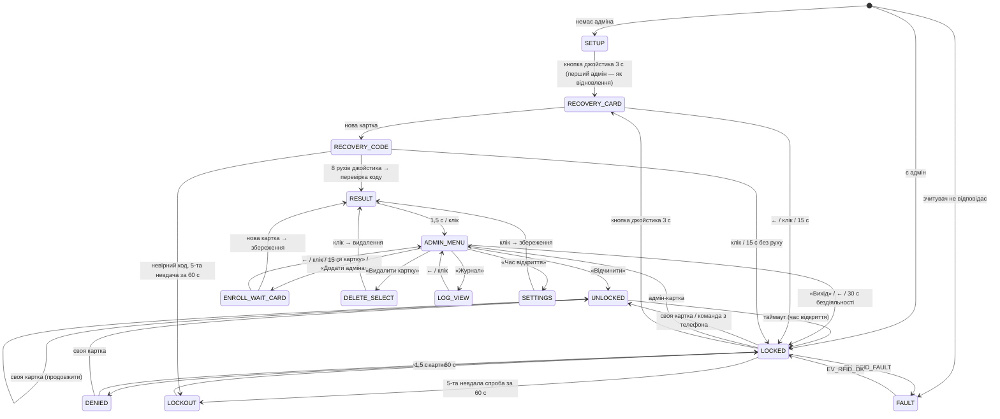

# Стан-машина доступу

Код: `App/Src/access_ctrl.c`, тести: `Tests/test_access_ctrl.c`.

«LOCKED» на діаграмі означає **базовий стан**: `FAULT`, якщо зчитувач несправний; `SETUP`, якщо немає жодного адміна; інакше `LOCKED`.

## Таблиця переходів

| Стан | Подія | Умова | Новий стан | Дії |
|---|---|---|---|---|
| LOCKED, DENIED, FAULT | `EV_CARD` | користувач | UNLOCKED | замок відкрити, таймер, звук OK, журнал `ACCESS_OK`, мережа, скинути лічильник невдач |
| LOCKED, DENIED, FAULT, UNLOCKED | `EV_CARD` | адмін | ADMIN_MENU | закрити замок (якщо був відкритий), таймер 30 с, журнал `ADMIN_LOGIN` |
| LOCKED, DENIED, FAULT | `EV_CARD` | невідома, < 5 невдач за 60 с | DENIED | звук «відмова», таймер 1,5 с, журнал `ACCESS_DENIED`, мережа |
| LOCKED, DENIED, FAULT, UNLOCKED | `EV_CARD` | невідома, 5-та за 60 с | LOCKOUT | закрити замок, сирена, таймер 60 с, журнал `LOCKOUT`, мережа |
| UNLOCKED | `EV_CARD` | користувач | UNLOCKED | перезапуск таймера |
| UNLOCKED | `EV_CARD` | невідома, < 5 невдач | UNLOCKED | звук «відмова», журнал (двері лишаються відчиненими до таймауту) |
| LOCKOUT | `EV_CARD` | будь-яка | LOCKOUT | звук «відмова», журнал; блокування не продовжується і не рахується |
| UNLOCKED / DENIED / меню / журнал / налаштування | `EV_TIMEOUT` | дедлайн настав | базовий | закрити замок |
| LOCKOUT | `EV_TIMEOUT` | дедлайн настав | базовий | скинути лічильник невдач |
| будь-який | `EV_TIMEOUT` | раніше дедлайну або таймер не активний | без змін | — (застаріла подія) |
| LOCKED, DENIED, SETUP, FAULT | `EV_RFID_FAULT` | — | FAULT | звук помилки, журнал, мережа |
| UNLOCKED, меню | `EV_RFID_FAULT` | — | без змін | прапорець несправності; після виходу → FAULT |
| FAULT | `EV_RFID_OK` | — | базовий | журнал `RFID_OK` |
| не меню | `EV_NET_UNLOCK` | — | UNLOCKED | журнал `NET_UNLOCK` |
| меню | `EV_NET_UNLOCK` | — | без змін | адміністратор біля пристрою — ігнор |
| ADMIN_MENU | ↑ / ↓ | — | ADMIN_MENU | курсор по колу, клік-звук, перезапуск таймера бездіяльності |
| ENROLL_WAIT_CARD | `EV_CARD` | — | RESULT | додати картку (адміна, якщо зайшли через «Додати адміна») і зберегти; випадковий UID і вже відома картка відхиляються; далі — назад у меню |
| DELETE_SELECT | клік / → | — | RESULT | видалити вибрану картку і зберегти; останнього адміна видалити не можна |
| SETTINGS | ↑ / ↓ | 1…30 с | SETTINGS | змінити значення (ще не збережене) |
| SETTINGS | клік / → | — | RESULT | зберегти час відкриття; якщо запис не вдався, лишається старий |
| SETUP | `EV_CARD` | — | SETUP | звук «відмова», журнал (адміна додають лише через код) |
| LOCKED, DENIED, SETUP | `EV_JOY_LONG` (кнопка джойстика 3 с) | — | RECOVERY_CARD | клік-звук, таймер 15 с |
| RECOVERY_CARD | `EV_CARD` | UID не випадковий | RECOVERY_CODE | запам'ятати картку, лічильник кроків = 0 |
| RECOVERY_CODE | ↑ ↓ ← → | < 8 кроків | RECOVERY_CODE | крок зараховано (правильний чи ні — не показується), точка на екрані |
| RECOVERY_CODE | 8-й рух | код правильний | RESULT | картка стає єдиним адміном, старі адмін-картки видаляються, звичайні лишаються; журнал `ADMIN_RECOVERY`, мережа |
| RECOVERY_CODE | 8-й рух | код невірний | RESULT / LOCKOUT | невдала спроба (як чужа картка), журнал `ACCESS_DENIED`, «Невірний код» |
| (будь-яка зміна списку) | — | запис у Flash не вдався | RESULT | зміна в RAM скасовується (копія `undo`), екран «Помилка Flash» |

## Інваріанти, які перевіряють тести

- Під час блокування навіть дійсна картка не відчиняє.
- Невдачі поза 60-секундним вікном не накопичуються; успішний вхід скидає лічильник.
- Замок закривається при кожному виході зі стану UNLOCKED і примусово — під час старту.
- Налаштування часу не застосовується без успішного запису у Flash.
- Жодна картка не стає адміном без коду відновлення (ні при першому налаштуванні, ні при заміні адміна).
- Помилка в коді відновлення не видна до 8-го кроку, а невірний код рахується як невдала спроба.

## Відновлення адміна

Якщо адмін-картку загубили:
1. утримувати кнопку джойстика 3 с (у стані «ЗАЧИНЕНО» або «НАЛАШТУВАННЯ») → екран «ВІДНОВЛЕННЯ»;
2. прикласти нову картку → «ВВЕДІТЬ КОД»;
3. ввести код джойстиком: ↑ ↑ ↓ ↓ ← → ← → (`CFG_RECOVERY_CODE` в `app_config.h`).

Так само додається і перший адмін на новому пристрої. Нова картка стає **єдиним** адміном: загублену могли знайти, тому всі старі адмін-картки видаляються. Звичайні картки лишаються.

Захист від підбору: замок не показує, на якому кроці помилка, а лише результат після всіх 8 кроків. Невірний код — це невдала спроба, і 5 невдач за хвилину блокують пристрій. Обмеження: код однаковий для всіх пристроїв із цією прошивкою і видно в коді, тож на реальному пристрої його треба змінити.
