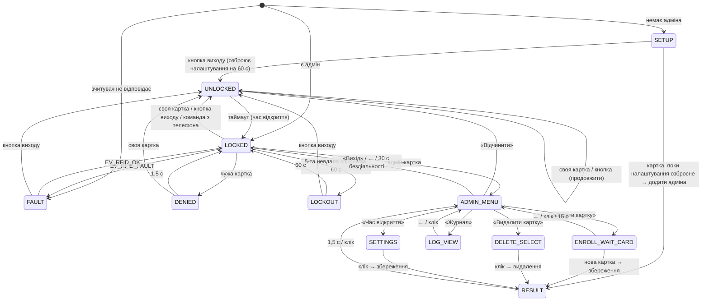

# Стан-машина доступу

Код: `App/Src/access_ctrl.c`, тести: `Tests/test_access_ctrl.c`.

«LOCKED» на діаграмі означає **базовий стан**: `FAULT`, якщо зчитувач несправний; `SETUP`, якщо немає жодного адміна; інакше `LOCKED`.

## Таблиця переходів

| Стан | Подія | Умова | Новий стан | Дії |
|---|---|---|---|---|
| будь-який | `EV_EXIT_BUTTON` | — | UNLOCKED | замок відкрити, таймер = час відкриття, звук OK, журнал `EXIT_BUTTON`; без адміна — озброїти налаштування на 60 с |
| LOCKED, DENIED, FAULT | `EV_CARD` | користувач | UNLOCKED | замок відкрити, таймер, звук OK, журнал `ACCESS_OK`, мережа, скинути лічильник невдач |
| LOCKED, DENIED, FAULT, UNLOCKED | `EV_CARD` | адмін | ADMIN_MENU | закрити замок (якщо був відкритий), таймер 30 с, журнал `ADMIN_LOGIN` |
| LOCKED, DENIED, FAULT | `EV_CARD` | невідома, < 5 невдач за 60 с | DENIED | звук «відмова», таймер 1,5 с, журнал `ACCESS_DENIED`, мережа |
| LOCKED, DENIED, FAULT, UNLOCKED | `EV_CARD` | невідома, 5-та за 60 с | LOCKOUT | закрити замок, сирена, таймер 60 с, журнал `LOCKOUT`, мережа |
| UNLOCKED | `EV_CARD` | користувач | UNLOCKED | перезапуск таймера |
| UNLOCKED | `EV_CARD` | невідома, < 5 невдач | UNLOCKED | звук «відмова», журнал (двері лишаються відчиненими до таймауту) |
| LOCKOUT | `EV_CARD` | будь-яка | LOCKOUT | звук «відмова», журнал; блокування не продовжується і не рахується |
| SETUP | `EV_CARD` | налаштування озброєне | SETUP → RESULT | команда `ENROLL_ADMIN` |
| SETUP | `EV_CARD` | не озброєне | SETUP | звук «відмова», журнал |
| UNLOCKED / DENIED / меню / журнал / налаштування | `EV_TIMEOUT` | дедлайн настав | базовий | закрити замок |
| LOCKOUT | `EV_TIMEOUT` | дедлайн настав | базовий | скинути лічильник невдач |
| будь-який | `EV_TIMEOUT` | раніше дедлайну або таймер не активний | без змін | — (застаріла подія) |
| LOCKED, DENIED, SETUP, FAULT | `EV_RFID_FAULT` | — | FAULT | звук помилки, журнал, мережа |
| UNLOCKED, меню | `EV_RFID_FAULT` | — | без змін | прапорець несправності; після виходу → FAULT |
| FAULT | `EV_RFID_OK` | — | базовий | журнал `RFID_OK` |
| не меню | `EV_NET_UNLOCK` | — | UNLOCKED | журнал `NET_UNLOCK` |
| меню | `EV_NET_UNLOCK` | — | без змін | адміністратор біля пристрою — ігнор |
| ADMIN_MENU | ↑ / ↓ | — | ADMIN_MENU | курсор по колу, клік-звук, перезапуск таймера бездіяльності |
| DELETE_SELECT | клік / → | — | (RESULT) | команда `DELETE(index)`; останнього адміна видалити не можна |
| SETTINGS | ↑ / ↓ | 1…30 с | SETTINGS | змінити значення (ще не збережене) |
| SETTINGS | клік / → | — | (RESULT) | команда `SAVE_SETTINGS`; новий час застосовується лише після успішного запису |
| (після команди) | `EV_CMD_RESULT` | ok / помилка | RESULT | екран «Готово» / «Помилка» з причиною, звук, журнал |

## Інваріанти, які перевіряють тести

- Кнопка виходу відчиняє двері в **кожному** стані, включно з блокуванням і збоєм зчитувача.
- Під час блокування навіть дійсна картка не відчиняє.
- Невдачі поза 60-секундним вікном не накопичуються; успішний вхід скидає лічильник.
- Замок закривається при кожному виході зі стану UNLOCKED і примусово — під час старту.
- Налаштування часу не застосовується без успішного запису у Flash.
- Жодна картка не стає адміном без кнопки виходу.
